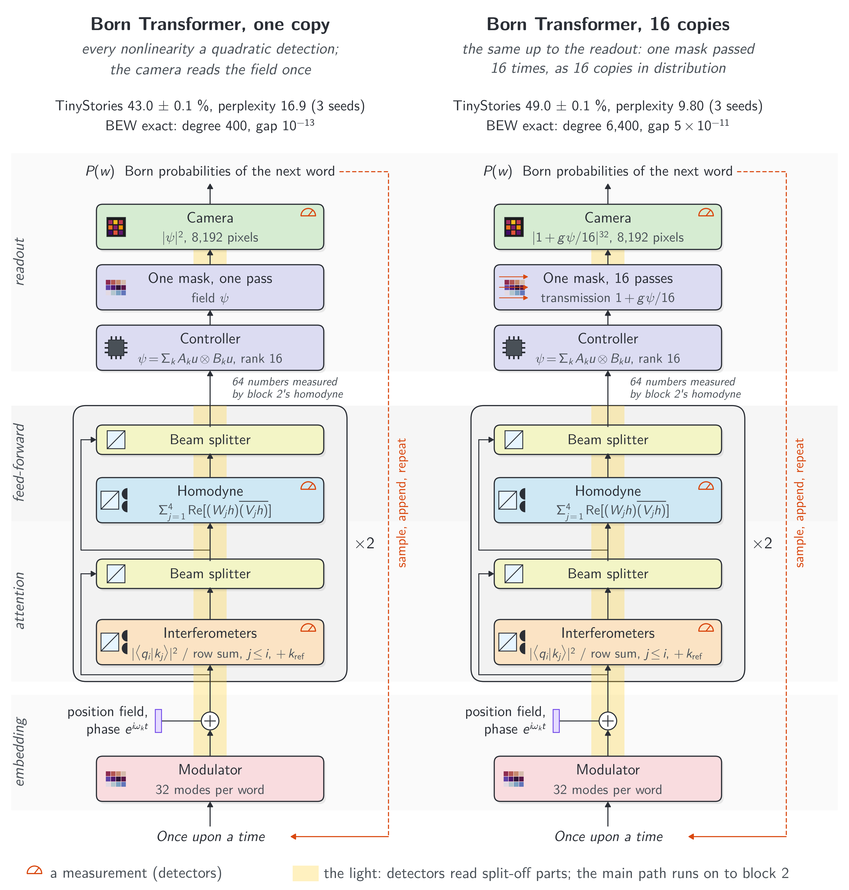
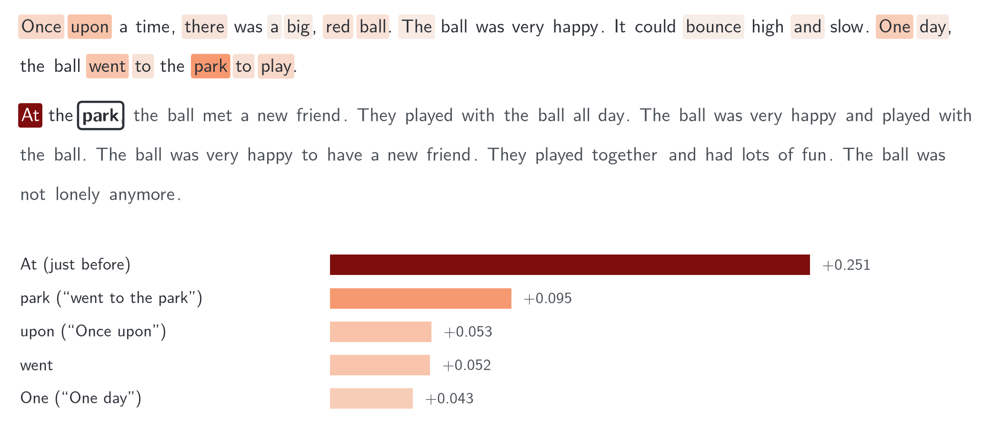

# Writing Why: Born-Rule Language Models with Exact Word Evidence

Companion to the paper by Teerawat Tongloy (KMITL), Jiraporn Pongsopa and Rangsan Jomtarak (Suan Dusit
University).

| | |
|---|---|
| Write a story and see why each word was chosen | [demo/demo.ipynb](demo/demo.ipynb) |
| Train a model, then let it write | [demo/train.ipynb](demo/train.ipynb) |
| Run it on your own computer, and the paper's analyses | [docs/run-locally.md](docs/run-locally.md) |
| Paper | arXiv identifier to be added |
| Series | 1. Seeing Why, [arXiv:2611.01993](https://arxiv.org/abs/2611.01993) ([code](https://github.com/stein-research/seeing-why)), pictures<br>2. Reading Why, [arXiv:2611.05355](https://arxiv.org/abs/2611.05355) ([code](https://github.com/stein-research/reading-why)), sentence pairs<br>3. Writing Why (this repository), a model that writes |



The two models, drawn as optics (simulated): one copy reads the readout state once, $|\psi|^2$; 16 copies passes one
mask 16 times, $|1+g\psi/16|^{32}$.

A small causal language model in which every nonlinearity is a quadratic detection (an interferometric overlap, a
balanced reading or a camera), with a classical controller between detections, and the next word is drawn from a
Born probability: attention $|\langle q|k\rangle|^2$, in the form of the Born rule, normalised over each row; measured
products in place of the feed-forward nonlinearity; and a readout over 8,192 words. Passing the readout's mask $n$
times sharpens it towards a softmax while each word's probability stays a ratio of polynomials in the words'
amplitudes, so its integrated-gradient evidence, with the denominators held, is computed exactly by a finite
quadrature: the **Born evidence per word (BEW)**. A causal Born-attention language model with a plain Born readout was trained earlier in CNet
(Crasmaru, arXiv:2610.08592, Sec. 11); what is added here is the sharp $n$-pass readout and the exact evidence.

## How it works

The readout state $\psi_w$ over the 8,192 words is a rank-16 product of the last block's measured numbers. The
$n$-pass readout reads

```math
P_n(w) = \frac{|1+g\psi_w/n|^{2n}}{\sum_v |1+g\psi_v/n|^{2n}}, \qquad \lim_{n\to\infty} P_n(w) = \frac{e^{2g\,\mathrm{Re}\,\psi_w}}{\sum_v e^{2g\,\mathrm{Re}\,\psi_v}},
```

a softmax only in the limit and a polynomial at every finite $n$. A related result is exact: Reinhardt and Hauser
(arXiv:2608.11173, Corollary 17) showed that $L$ post-selected rounds of a Born measurement, each set to succeed
with probability $e^{z}$, give the softmax at inverse temperature $L$. Here each pass is a polynomial factor, and
only the limit $n\to\infty$ is the exponential. With every
normaliser held at its value for the actual input, the explained quantity $F(a)$, equal to $P(w) - 1/V$ at that
input, is a polynomial of degree $D = 400n$ in the word amplitudes, and integrated gradients over the earlier words,

```math
e_t = a_t \int_0^1 \frac{\partial F}{\partial a_t}(\alpha a_{\lt i},\, a_i)\,d\alpha, \qquad \sum_{t \lt i} e_t = P(w) - \tfrac{1}{V} - F_q,
```

are computed with no quadrature error by $D/2$ Gauss-Legendre nodes ($F_q$ is the query-only baseline term: the
current word stays at its amplitude along the path). In double precision the sum holds to $6\times10^{-11}$.



## What the paper finds

| | 16 copies | one copy | softmax transformer |
|---|---|---|---|
| TinyStories V2 next-word accuracy (3 seeds) | 49.0 +- 0.1 % | 43.0 +- 0.1 % | 50.9 +- 0.3 % |
| WikiText-103 (3 seeds) | 27.8 +- 0.2 % | | 29.9 +- 0.1 % |
| evidence sums to the explained score | to 6e-11 (no quadrature error) | to 1e-13 | integrated gradients, approximate |

The same body trained with the readout's softmax limit scores the same (49.0 +- 0.1 %, three seeds), which suggests
that the gap to the softmax transformer arises elsewhere in the architecture or its optimisation, not in the
finite-pass readout. At copy positions the exact evidence ranks words
as gradient times input does: what it adds is exactness, not a better ranking. In simulation the weights compile
exactly to an opto-electronic system (interferometer meshes, balanced detectors, modulators, a controller and a
16-pass mask); the controller does most of the arithmetic, and the paper lists what the simulation idealises. Numbers will be updated to the final paper.

## Contents

| | |
|---|---|
| [`demo/`](demo/) | the two notebooks and their engine, [`writing_why.py`](demo/writing_why.py) |
| [`src/`](src/) | the models, the trainer, sampling, the exact evidence and the evaluations, the optical compile and its mesh check, and the scripts that draw the figures |
| [`results/`](results/) | the trained models of the paper (three seeds of each model in Table 1 and of the softmax-limit readout, the pass-count ladder, the mesh fine-tune), the evaluation records, the samples' token ids, and the two vocabularies |
| [`data/`](data/) | where TinyStories V2 and WikiText-103 go (downloaded and checked, not stored) |
| [`docs/`](docs/) | [running it locally and reproducing the paper](docs/run-locally.md); the figures of this page |

## A century of the Born rule

> In 1926, Max Born gave the rule that a measurement finds an outcome with probability given by the squared modulus of
> its amplitude. Decades earlier, Ludwig Boltzmann and J. Willard Gibbs had developed the statistical foundations of
> the weight $e^{-E/(k_BT)}$. The same exponential normalisation appears today as softmax in the readout of most
> language models.
>
> In this work, the two meet. Passing light through a suitably chosen mask $n$ times gives weights
> $|1+g\psi/n|^{2n}$, which approach $e^{2g\operatorname{Re}\psi}$ through the limit $(1+z/n)^n\to e^z$, with $2g$
> playing the role of inverse temperature. At every finite $n$, the readout remains a Born probability, while its word
> evidence—with the normalisers held at their input values—admits exact finite quadrature. We complete this work in
> the rule’s hundredth year, in gratitude to Born, Boltzmann and Gibbs.

## Use of AI tools

An AI assistant (Claude, Anthropic) was used under the authors' direction to write and run simulation and analysis
code, to write the code that draws the figures, to search the literature and check the references against their
sources, and to draft and revise the text; the authors chose what to cite. The authors retained responsibility for
the study design, the scientific judgments and the claims, checked the reported results against the saved data and
the code, and take full responsibility for the content.

## Licence and citation

Code: MIT ([`LICENSE`](LICENSE)). TinyStories: CDLA-Sharing-1.0; WikiText-103: CC BY-SA and GFDL; the vocabularies
derived from them keep those licences (see [`data/README.md`](data/README.md)). Please cite the paper
([`CITATION.cff`](CITATION.cff)).
