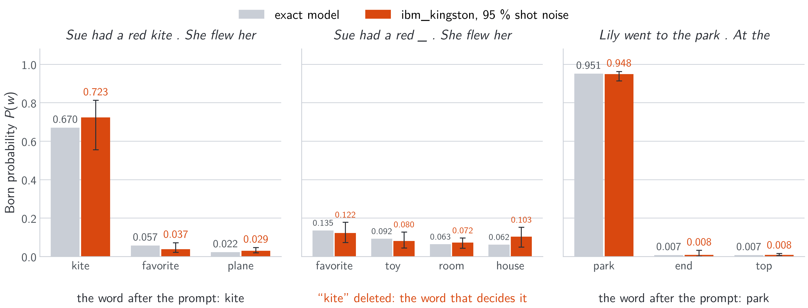

# Writing Why: Born-Rule Language Models with Exact Word Evidence on Light and Qubits

Companion to the paper by Teerawat Tongloy (KMITL), Jiraporn Pongsopa and Rangsan Jomtarak (Suan Dusit
University).

| | |
|---|---|
| Write a story and see why each word was chosen | [demo/demo.ipynb](demo/demo.ipynb) |
| Train a model, then let it write | [demo/train.ipynb](demo/train.ipynb) |
| Run it on your own computer, and the paper's analyses | [docs/run-locally.md](docs/run-locally.md) |
| Check the IBM runs from their raw counts (no account), or repeat them | [docs/check-and-repeat-ibm.md](docs/check-and-repeat-ibm.md) |
| Paper | arXiv identifier to be added |
| Series | 1. Seeing Why, [arXiv:2611.01993](https://arxiv.org/abs/2611.01993) ([code](https://github.com/stein-research/seeing-why)), pictures<br>2. Reading Why, [arXiv:2611.05355](https://arxiv.org/abs/2611.05355) ([code](https://github.com/stein-research/reading-why)), sentence pairs<br>3. Writing Why (this repository), a model that writes |


*(a) On light (simulated): the prompt's words as fields on a modulator; in each of two blocks Born attention weighs
the earlier words by interference and a measured feed-forward reads products; the controller writes a mask that the
light passes 16 times, and the camera, one pixel per word, gives the next word; each earlier word's exact evidence
(BEW) sums to the word's probability above its share. (b) On IBM's ibm_kingston, with the same weights: every
attention overlap read by Hadamard tests on five qubits, with calibration circuits in the same job; the device gives
the same word, one of 8,192, and each word's evidence with the device's row sums follows the exact one (r = 0.995).*

A small causal language model, simulated as an opto-electronic system on classical coherent light, in which every
nonlinearity on the light is a quadratic detection (an interferometric overlap, a balanced reading or a camera) and
the next word is drawn from a Born probability; between detections a classical controller squares, multiplies and
divides measured numbers (the attention weights, the normalisations, the readout's state). The model has attention $|\langle q|k\rangle|^2$, in the form of the Born rule, normalised over each row; measured
products in place of the feed-forward nonlinearity; and a readout over 8,192 words. Passing light through the readout's mask $n$
times sharpens it towards a softmax ($(1+x/n)^n$, for real $x \ge -n$, is the tempered exponential at $t=1-1/n$; Amid et al., NeurIPS
2019) while each word's probability stays a ratio of polynomials in the words'
amplitudes, so its integrated-gradient evidence, with the denominators held, is computed exactly by a finite
quadrature: the **Born evidence per word (BEW)**. This exactness follows from the model being a polynomial once its
normalisers are held; the Born construction is one such model that also compiles to optics. On light no quantum
resource is used: "Born" names the $|\text{amplitude}|^2$ detection law. The same weights also run with their
attention read on a quantum computer. A causal Born-attention language model with a plain Born readout was trained earlier in CNet
(Crasmaru, arXiv:2610.08592, Sec. 11); what is added here is the sharp $n$-pass readout and the exact evidence.

## How it works


*The two models, drawn as optics (simulated): the plain readout reads the readout state once, $|\psi|^2$; the
16-pass readout passes light through one mask 16 times, $|1+g\psi/16|^{32}$.*

The readout field $\psi_w$ over the 8,192 words is constructed as a rank-16 factorisation across a $64\times128$ grid
from the last block's measured outputs. The $n$-pass readout gives

```math
P_n(w) = \frac{|1+g\psi_w/n|^{2n}}{\sum_v |1+g\psi_v/n|^{2n}}, \qquad \lim_{n\to\infty} P_n(w) = \frac{e^{2g\,\mathrm{Re}\,\psi_w}}{\sum_v e^{2g\,\mathrm{Re}\,\psi_v}}.
```

It is a softmax only in the limit and a ratio of polynomials at every finite $n$. A related construction is exact:
Reinhardt and Hauser (arXiv:2608.11173, Corollary 17) showed that $L$ post-selected rounds, each with success
probability $e^z$ for nonpositive scores $z$, give softmax weights at inverse temperature $L$. Here each pass supplies
a polynomial factor; only the limit $n\to\infty$ yields the exponential.

With every normaliser held at its value for the actual input, the explained quantity $F(a)$, equal to $P(w)-1/V$ at
that input, is a polynomial of degree at most $D=400n$ in the word amplitudes. Its integrated gradients over the
earlier words,

```math
e_t = a_t \int_0^1 \frac{\partial F}{\partial a_t}(\alpha a_{\lt i},\, a_i)\,d\alpha, \qquad \sum_{t \lt i} e_t = P(w) - \tfrac{1}{V} - F_q,
```

are computed without quadrature error by $D/2$ Gauss–Legendre nodes. Here $F_q$ is the query-only baseline term: the
current word remains at its input amplitude along the path. In the reported double-precision evaluations, the
numerical completeness gap is at most $5.2\times10^{-11}$ over the positions tested.


Why the model wrote "park": each earlier word's exact share, deeper red for a larger push; grey words came after.

## What the paper finds

| | 16 passes | plain readout | softmax transformer |
|---|---|---|---|
| TinyStories V2 next-word accuracy (3 seeds) | 49.0 +- 0.1 % | 43.0 +- 0.1 % | 51.2 +- 0.3 % |
| WikiText-103 (3 seeds) | 27.8 +- 0.2 % | | 30.2 +- 0.0 % |
| evidence sums to the explained score | to 5.2e-11 (no quadrature error) | to 1e-13 | integrated gradients, approximate |

On TinyStories the same body trained with the readout's softmax limit scores the same (49.0 +- 0.1 %, three
seeds) and with an ordinary linear softmax head less (48.1 +- 0.1 %): under the training setup tested, neither
replacement closes the gap to the softmax transformer. At copy positions the exact evidence ranks words
as gradient times input does: what it adds is exact accounting, not a better ranking. In simulation the weights compile
exactly to an opto-electronic system (interferometer meshes, balanced detectors, modulators, a controller and a
16-pass mask); the controller does most of the arithmetic, and the paper lists what the simulation idealises. The
softmax transformer's learning rate and warm-up were searched (nine settings).

### On a quantum computer


With every attention overlap of a written word read by Hadamard tests on IBM's ibm_kingston (the feed-forward and the
readout as simulated light), and the pass criteria fixed before any job was sent:

| prompt | exact | ibm_kingston (95 % shot-noise interval) | evidence with the device's row sums |
|---|---|---|---|
| Lily went to the park . At the | park 0.951 | park 0.948 (0.914-0.961) | r = 0.995 (0.964-0.999) |
| Sue had a red kite . She flew her | kite 0.670 | kite 0.723 (0.568-0.812) | r = 0.998 (0.990-1.000) |
| the same, "kite" deleted | favorite 0.135 | favorite 0.122; kite in none of 200 redraws | answer only |



Six jobs, 389 quantum seconds; every job's circuits, calibration and raw counts are in [`ibm_jobs/`](ibm_jobs/). The
device reads overlaps a classical computer also computes: no quantum advantage is claimed, and two prompts and one
deletion are a demonstration, not statistics. The evidence test has little power (the numerators stay exact; with the
row sums permuted among the rows the correlation is still 0.99), and the deletion mainly checks that the device does
not bring a deleted word back.

## Contents

| | |
|---|---|
| [`demo/`](demo/) | the two notebooks and their engine, [`writing_why.py`](demo/writing_why.py) |
| [`src/`](src/) | the models, the trainer, sampling, the exact evidence and the evaluations, the optical compile and its mesh check, and the scripts that draw the figures |
| [`results/`](results/) | the trained models of the paper (three seeds of each model in Table 1 and of the softmax-limit readout, the pass-count ladder, the mesh fine-tune), the evaluation records, the samples' token ids, and the two vocabularies |
| [`data/`](data/) | where TinyStories V2 and WikiText-103 go (downloaded and checked, not stored) |
| [`docs/`](docs/) | [running it locally and reproducing the paper](docs/run-locally.md); [checking and repeating the IBM runs](docs/check-and-repeat-ibm.md); the figures of this page |
| [`ibm_jobs/`](ibm_jobs/) | the record of every job run on IBM's ibm_kingston: job id, times, calibration, qubits, circuits as built and as sent, raw counts (account details removed); see [`ibm_jobs/README.md`](ibm_jobs/README.md) |

## A century of the Born rule

> In 1926, Max Born gave the rule that a measurement finds an outcome with probability given by the squared modulus of
> its amplitude. Decades earlier, Ludwig Boltzmann and J. Willard Gibbs had developed the statistical foundations of
> the weight $e^{-E/(k_BT)}$. The same exponential normalisation appears today as softmax in the readout of most
> language models.
>
> In this work, the two meet. Passing light through a suitably chosen mask $n$ times gives weights
> $|1+g\psi/n|^{2n}$, which approach $e^{2g\mathrm{Re}\psi}$ through the limit $(1+z/n)^n\to e^z$, with $2g$
> playing the role of inverse temperature. At every finite $n$, the readout remains a Born probability, while its word
> evidence—with the normalisers held at their input values—admits exact finite quadrature. We complete this work in
> the rule’s hundredth year, in gratitude to Born, Boltzmann, Gibbs
> and the many others whose work this one rests on.
>
> If this work stands, it stands on their shoulders. What we add is small: another way to use Born’s rule, to write
> a word and show how each earlier word contributed to its predicted probability.
>
> *The authors, 10 November 2026*

## Acknowledgements

We acknowledge the use of IBM Quantum services for this work. The views expressed are those of the authors, and do
not reflect the official policy or position of IBM or the IBM Quantum team.

## Use of AI tools

An AI assistant (Claude, Anthropic) was used under the authors' direction to write and run simulation and analysis
code, to prepare and check the hardware jobs, to write the code that draws the figures, to search the literature and check the references against their
sources, and to draft and revise the text; the authors chose what to cite. The authors retained responsibility for
the study design, the scientific judgments and the claims, checked the reported results against the saved data and
the code, and take full responsibility for the content.

## Licence and citation

Code: MIT ([`LICENSE`](LICENSE)). TinyStories: CDLA-Sharing-1.0; WikiText-103: CC BY-SA and GFDL; the vocabularies
derived from them keep those licences (see [`data/README.md`](data/README.md)). Please cite the paper
([`CITATION.cff`](CITATION.cff)).
