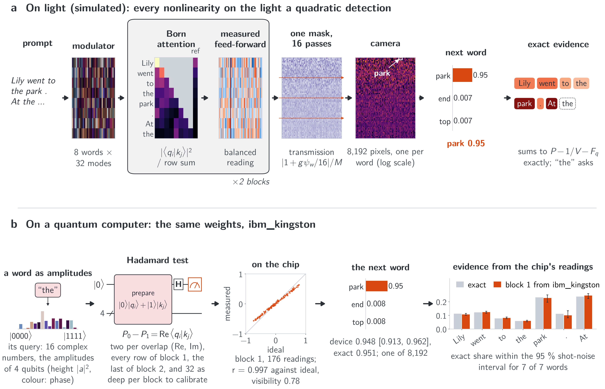
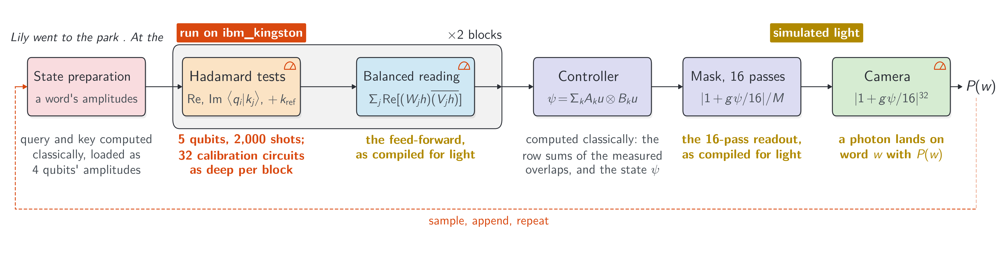

# Writing Why: Born-Rule Language Models, Their Exact Word Evidence and Its Limits, for Coherent Light and Qubits

Companion to the paper by Teerawat Tongloy<sup>1</sup>, Jiraporn Pongsopa<sup>2</sup> and Rangsan Jomtarak<sup>2</sup>.

<sup>1</sup> School of Integrated Innovative Technology, King Mongkut's Institute of Technology Ladkrabang (KMITL), Bangkok, Thailand<br>
<sup>2</sup> Faculty of Science and Technology, Suan Dusit University, Bangkok, Thailand

| | |
|---|---|
| Write a story and see why each word was chosen | [demo/demo.ipynb](demo/demo.ipynb) |
| Train a model, then let it write | [demo/train.ipynb](demo/train.ipynb) |
| Run it on your own computer, and the paper's analyses | [docs/run-locally.md](docs/run-locally.md) |
| Check the IBM runs from their raw counts (no account), or repeat them | [docs/check-and-repeat-ibm.md](docs/check-and-repeat-ibm.md) |
| Paper | arXiv identifier to be added |
| Archived copy (always the latest version) | [doi:10.5281/zenodo.24161974](https://doi.org/10.5281/zenodo.24161974) |
| Series | 1. Seeing Why, [arXiv:2611.01993](https://arxiv.org/abs/2611.01993) ([code](https://github.com/stein-research/seeing-why)), pictures<br>2. Reading Why, [arXiv:2611.05355](https://arxiv.org/abs/2611.05355) ([code](https://github.com/stein-research/reading-why)), sentence pairs<br>3. Writing Why (this repository), a model that writes |



*One written word, "park", through the trained 16-pass model: (a) on light (simulated), (b) with its attention
overlaps measured on IBM's ibm_kingston. Red words raised the probability of "park".*

A small causal language model in which every nonlinearity on the light is a quadratic detection, so the next word
is drawn from a Born probability. Passing light *n* times through one mask sharpens the readout towards a softmax,
while each word's probability stays a ratio of polynomials in the words' amplitudes. With its normalisers held, the
evidence for every word it writes, the **Born evidence per word (BEW)**, is then exact. The paper also measures how
far that exactness goes.

## How it works


*The two models, drawn as optics (simulated): the plain readout reads the state once, |ψ|²; the 16-pass readout
passes light through one mask 16 times, |1 + gψ/16|³².*

```math
P_n(w) = \frac{|1+g\psi_w/n|^{2n}}{\sum_v |1+g\psi_v/n|^{2n}}, \qquad \lim_{n\to\infty} P_n(w) = \frac{e^{2g\,\mathrm{Re}\,\psi_w}}{\sum_v e^{2g\,\mathrm{Re}\,\psi_v}}.
```

- At every finite *n* the readout is a normalised tempered exponential, a ratio of polynomials; only the limit is
  the softmax.
- On qubits the *n* passes are *n* post-selected rounds; their acceptance rate is the light that reaches the camera.

**Born evidence per word (BEW)** is the integrated gradient of the probability with its normalisers held at their
values for the actual input. That held function $F$ is a polynomial of degree at most $D = 400n$ in the word
amplitudes, so $D/2$ Gauss-Legendre nodes compute each earlier word's share with no quadrature error, and the
shares add up exactly ($F_q$: the current word alone):

```math
e_t = a_t \int_0^1 \frac{\partial F}{\partial a_t}(\alpha a_{\lt i},\, a_i)\,d\alpha, \qquad \sum_{t \lt i} e_t = P(w) - \tfrac{1}{V} - F_q .
```


*Why the model wrote "park": each earlier word's exact share, deeper red for a larger push; grey words came after.*

## What the paper finds

| | 16 passes | plain readout | softmax transformer |
|---|---|---|---|
| TinyStories V2 next-word accuracy (3 seeds) | 49.0 ± 0.1 % | 43.0 ± 0.1 % | 51.2 ± 0.3 % |
| WikiText-103 (3 seeds) | 27.8 ± 0.2 % | | 30.18 ± 0.04 % |

- **Writing.** Sixteen passes come within 2.2 points of a softmax transformer of the same size. The same body read at
  the softmax limit scores the same, so the gap is in the body, not the readout.
- **Exact, and its limit.** BEW is exact for the held polynomial (gap 5e-11), but that polynomial follows the
  probability only near the input. With the earlier words scaled by 0.99 it keeps 10.5 % of its value, while the
  probability keeps 99.5 %. So on 16
  passes BEW closely matches gradient × input. Integrated gradients of the real probability agree far better with the
  model's own word deletions: Spearman 0.70, against 0.21 for BEW.
- **Why.** One held normaliser, the readout's scale, causes most of the fall near the input.
- **Light.** In simulation the weights compile exactly to an opto-electronic system; the paper lists what it
  idealises.

### On a quantum computer



| on ibm_kingston | result |
|---|---|
| the attention overlaps, read by Hadamard tests (two prompts, one deletion) | the model's top word in every run; with block 1's measured attention, 14 of 15 word shares within shot noise of the exact ones (14 of 15 outside with an uninformative attention) |
| the readout as post-selected rounds, 16 words on 4 qubits, n = 1, 2, 4 | failed the criteria fixed before the job at n = 2 and 4 (a coherent two-qubit error); with gate twirling, a diagnostic after the fact, it passed them and moved towards the softmax limit as *n* grew |

Eight jobs, 436 quantum seconds, every one recorded in [`ibm_jobs/`](ibm_jobs/) with its raw counts. A demonstration,
not statistics, and no quantum advantage is claimed. The numbers behind every line, and the command that gives each,
are in [docs/run-locally.md](docs/run-locally.md) and [docs/check-and-repeat-ibm.md](docs/check-and-repeat-ibm.md).

## Contents

| | |
|---|---|
| [`demo/`](demo/) | the two notebooks and their engine, [`writing_why.py`](demo/writing_why.py) |
| [`src/`](src/) | the models, the trainer, sampling, the exact evidence and the evaluations, the optical compile and its mesh check, and the scripts that draw the figures |
| [`results/`](results/) | the trained models (three seeds of each model of the paper, the pass-count ladder, the mesh fine-tune), the evaluation records and checks, the device runs and their plans, and the two vocabularies |
| [`data/`](data/) | where TinyStories V2 and WikiText-103 go (downloaded and checked, not stored) |
| [`docs/`](docs/) | [running it locally and reproducing the paper](docs/run-locally.md); [checking and repeating the IBM runs](docs/check-and-repeat-ibm.md); the figures of this page |
| [`ibm_jobs/`](ibm_jobs/) | the record of every job run on IBM's ibm_kingston: job id, times, calibration, qubits, circuits as built and as sent, raw counts (account details removed); see [`ibm_jobs/README.md`](ibm_jobs/README.md) |

## A century of the Born rule

> In 1926, Max Born gave the rule that a measurement finds an outcome with probability given by the squared modulus of
> its amplitude. Decades earlier, Ludwig Boltzmann and J. Willard Gibbs had developed the statistical foundations of
> the weight $e^{-E/(k_BT)}$. The same exponential normalisation appears today as softmax in the readout of most
> language models.
>
> In this work, the two meet. Passing light through a suitably chosen mask $n$ times gives weights
> $|1+g\psi/n|^{2n}$, which approach $e^{2g\mathrm{Re}\psi}$ through the limit $(1+z/n)^n\to e^z$, with $2g$
> playing the role of inverse temperature. At every finite $n$, the readout remains a Born probability, while its word
> evidence—with the normalisers held at their input values—admits exact finite quadrature. We complete this work in
> the rule’s hundredth year, in gratitude to Born, Boltzmann, Gibbs
> and the many others whose work this one rests on.
>
> If this work stands, it stands on their shoulders. What we add is small: another way to use Born’s rule, to write
> a word and show how each earlier word contributed to its predicted probability.
>
> *The authors, 10 November 2026*

## Acknowledgements

We acknowledge the use of IBM Quantum services for this work. The views expressed are those of the authors, and do
not reflect the official policy or position of IBM or the IBM Quantum team.

## Use of AI tools

An AI assistant (Claude, Anthropic) was used under the authors' direction to write and run simulation and analysis
code, to prepare and check the hardware jobs, to write the code that draws the figures, to search the literature and check the references against their
sources, and to draft and revise the text; the authors chose what to cite. The authors retained responsibility for
the study design, the scientific judgments and the claims, checked the reported results against the saved data and
the code, and take full responsibility for the content.

## Licence and citation

Code: MIT ([`LICENSE`](LICENSE)). TinyStories: CDLA-Sharing-1.0; WikiText-103: CC BY-SA and GFDL; the vocabularies
derived from them keep those licences (see [`data/README.md`](data/README.md)). Please cite the paper
([`CITATION.cff`](CITATION.cff)).
